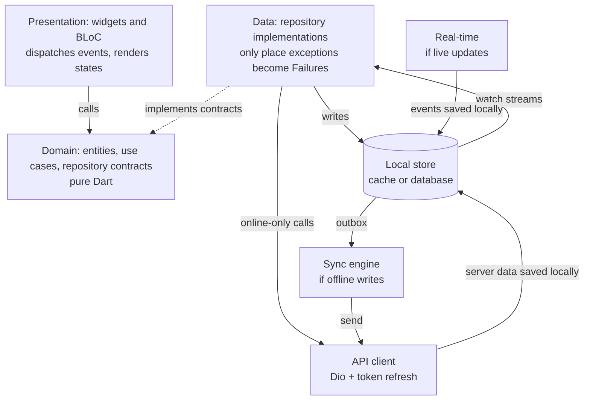

# Flutter Production Architecture Guide

Last updated: 2026-10-06

## Purpose and scope

This is a project-independent architecture for production Flutter apps: feature-first Clean Architecture with BLoC and a REST backend. Every new project starts from it and records its project-specific choices in the **Project decisions register** near the end.

- **Audience:** a solo developer today; written so new developers can join without a walkthrough.
- **Baseline stack (same in every project):** Flutter stable, flutter_bloc + bloc_concurrency, fpdart, Dio + Retrofit, freezed + json_serializable, get_it + injectable, go_router, flutter_secure_storage, very_good_analysis, mocktail + bloc_test.
- **Conditional stack (chosen per project):** local database, real-time transport, crash/analytics vendor, CI/CD provider, auth method — each marked below.
- **Not covered:** backend design, visual design, store listing.

**How to read this guide**

- **MUST** is enforced by lint, a package boundary or CI. **SHOULD** needs a reason in the PR to break. **MAY** is optional.
- A block starting with **[Needs project info to decide]** is a choice this guide cannot make without knowing the project. It lists the options and when each fits. Decide it at project kickoff, write the answer in the register, and treat it as a MUST for that project.

> **[Needs project info to decide]** Example format. *Question:* what has to be chosen. *Options:* A — when it fits; B — when it fits. *Default if unsure:* the safest starting point.

## Core principles

Dependencies point inward, repositories are the single source of truth, and the server owns every rule that matters for trust.

1. **Dependencies point inward (MUST).** `presentation → domain ← data`. Domain is pure Dart: no Flutter, Dio, database or JSON imports. Data and presentation never import each other.
2. **Repositories are the single source of truth (MUST).** The UI gets data only from repositories, never from a data source, cache or socket directly.
3. **Errors are values above the repository (MUST).** Data sources throw typed exceptions; repositories return `Either<Failure, T>`; nothing above a repository uses try/catch.
4. **Immutable models, unidirectional data flow (MUST).** Events go down, state comes up; models are `freezed`.
5. **The server is the authority (MUST).** Permissions, payments, limits, validation and anything security-related are enforced server-side. The client renders and requests.
6. **Boring and consistent beats clever.** One way to do each thing. A new pattern needs an entry in this guide first.
7. **Every rule has a home.** Business rule → entity/use case. Wire format → model. Storage choice → data source. Wording → presentation (localised).

> **[Needs project info to decide]** *Question:* what backs the repository's "source of truth"? *Options:* **Network only** — content always fetched fresh, little offline value (admin tools, dashboards). **Cache in front of network** — data should show instantly but writes need a connection (catalogues, feeds, profiles). **Local database as the source of truth** — users work offline or the UI must react to background changes (chat, notes, field data collection; Messenger's architecture). *Default if unsure:* cache in front of network; it can be upgraded per feature later without touching presentation. See Local data and offline.



Dependencies run down to the domain contracts; data runs up through repositories. The local store, sync engine and real-time boxes exist only if the project's decisions call for them; the API client is always present.

## Project structure

One app with feature folders, plus small packages for everything that knows nothing about the app's features.

```
my_app/
├── lib/
│   ├── bootstrap.dart          # error handlers, observers, DI init, runApp
│   ├── main_<flavor>.dart      # one entry point per flavor
│   ├── app/                    # MaterialApp.router, theme, l10n wiring
│   ├── di/                     # composition root (get_it + injectable)
│   ├── router/                 # go_router, guards, deep links
│   └── features/
│       └── <feature>/          # one folder per business capability
│           ├── domain/         # entities/ repositories/ usecases/
│           ├── data/           # dtos/ datasources/ mappers/ repositories/
│           └── presentation/   # bloc/ view/ widgets/
├── test/                       # mirrors lib/
└── packages/
    ├── core/          # Failure, guard, UseCase, logger interface (pure Dart)   — always
    ├── api_client/    # Dio setup, interceptors, error mapping                 — always
    ├── ui_kit/        # design tokens, theme, shared widgets                    — always
    ├── l10n/          # ARB files + generated localizations                     — always
    ├── analytics/     # Analytics interface + implementation                    — always
    ├── local_db/      # local database, tables, migrations         — if a local store is chosen
    ├── sync_engine/   # outbox + retry scheduler                   — if any offline writes
    └── realtime/      # socket/stream client                       — if live updates
```

- **Feature-first, then layer (MUST).** Everything about one capability lives in `features/<feature>/`.
- **Shared code knows no feature (MUST).** If a widget or helper mentions a business concept, it belongs in that feature, not in `packages/`. Test: could you publish it on pub.dev and a stranger use it unchanged?
- **Features don't import each other's `data/` or `presentation/` (MUST).** A feature may depend on another feature's `domain/`. Cross-feature navigation goes through named routes.
- **Barrel files:** one per layer folder, exporting only the public API.

> **[Needs project info to decide]** *Question:* how strictly are boundaries enforced? *Options:* **Folders in one package + import lint** — one app, one or two developers. **Pub workspace with shared packages** (above) — the default for anything you'll maintain over a year. **Feature-first packages** (`<feature>_domain`, `_data`, `_presentation`, VGV's FFCA) — several apps share features, several teams own features, or AI tools generate a lot of the code. *Default if unsure:* pub workspace with shared packages; split a feature into packages when a second app or owner appears.

## Layer rules

Each layer has one job, one model type, and one way to talk to the layer below.

| Layer | Owns | Model type | Talks to | May import |
| --- | --- | --- | --- | --- |
| Domain | Entities, business rules, repository contracts, use cases | Entity (freezed, no JSON) | nothing | `core`, fpdart, freezed_annotation |
| Data | DTOs, local rows, mappers, data sources, repository impls | DTO / local row | API, local store, sockets, platform | domain, `api_client`, `local_db`, `realtime`, `sync_engine` |
| Presentation | Blocs/cubits, pages, views, widgets, user-facing text | State (freezed or sealed) | use cases / repositories | domain, `ui_kit`, `l10n`, flutter_bloc |

### Domain

Entities are immutable and carry their own rules. Repository contracts return `Future<Either<Failure, T>>` for one-shot work and `Stream<T>` for data the UI keeps watching.

```dart
@freezed
abstract class Item with _$Item {
  const Item._();
  const factory Item({
    required String id,
    required String title,
    required DateTime updatedAt,
    required ItemStatus status,
  }) = _Item;

  bool get isEditable => status != ItemStatus.archived; // rule lives here
}

abstract interface class ItemRepository {
  Stream<List<Item>> watchItems();                         // UI keeps watching
  Future<Either<Failure, Item>> getItem(String id);         // one-shot read
  Future<Either<Failure, Unit>> saveItem(Item item);        // write
  Future<Either<Failure, Unit>> loadMore({required String cursor});
}
```

> **[Needs project info to decide]** *Question:* when is a use case required? *Options:* **Always** — every bloc call goes through a use case; most uniform, most boilerplate; suits teams and long-lived apps. **Only when logic exists** — a use case when an action spans repositories or adds a rule; plain reads call the repository directly (the Flutter team's recommendation for most apps). **Never** — blocs call repositories; fine for small, CRUD-style apps. *Default if unsure:* only when logic exists, applied consistently within each feature.

### Data

Keep the wire format, the stored format and the domain model apart; one class doing all three leaks backend changes into business logic.

- **DTO** (`ItemDto`, `json_serializable`) — matches the API exactly.
- **Local row** (`ItemRow`) — matches the table, only if a local database is used.
- **Entity** (`Item`) — what the app reasons about.

Mappers are extension methods in `data/mappers/` (`ItemDto.toEntity()`, `ItemRow.toEntity()`), unit-tested for every field that needs conversion. Repository implementations are the only place exceptions become failures.

> **[Needs project info to decide]** *Question:* separate DTO and entity classes, or one? *Options:* **Separate DTO + entity with mappers** — backend you don't fully control, API shape differs from UI needs, or a local database adds a third shape. **One freezed model used everywhere** — small app, backend built for this client, payloads already match the UI. *Default if unsure:* separate; the cost is a mapper file, the saving is every future backend rename.

**Why freezed and json_serializable both appear:** json_serializable only generates `fromJson`/`toJson`. freezed generates `==`/`hashCode`, `copyWith`, `toString`, immutability and sealed unions. Entities and bloc states use freezed without JSON (domain must not know the wire format); DTOs use json_serializable (or freezed with `fromJson`, which runs json_serializable underneath). Equatable is not used: freezed already provides value equality without a hand-maintained `props` list.

### Presentation

- Page = creates and provides the bloc (reads dependencies from DI). View = consumes it and is what widget tests target.
- Widgets contain no logic beyond showing/hiding, layout and animation.
- Side effects (snackbar, dialog, navigation) only in `BlocListener` / `listener`; drawing only in `builder`.
- Every user-facing string comes from `l10n`. Failures map to text in presentation, never in domain.

> **[Needs project info to decide]** *Question:* which languages ship at launch? *Options:* one language, but still through `l10n` so adding more is cheap; several languages, including right-to-left (Arabic, Urdu) which adds directional layout checks; non-Latin scripts such as Bengali, which need font coverage and golden tests per script. *Default:* always use `l10n`, even with one language.

## Error handling

Exceptions are typed and thrown only in the data layer; the repository converts them into a sealed `Failure`, and every unknown error is reported before it is returned.

**1. Typed exceptions, mapped once.** `api_client` converts every `DioException` into an `ApiException` subtype. No other code inspects status codes.

```dart
sealed class ApiException implements Exception {
  const ApiException([this.message]);
  final String? message;
}
final class NetworkException extends ApiException {}      // no connection, DNS, socket
final class TimeoutException extends ApiException {}
final class UnauthorizedException extends ApiException {} // 401 after refresh failed
final class ForbiddenException extends ApiException {}    // 403
final class NotFoundException extends ApiException {}
final class ConflictException extends ApiException {}     // 409
final class ValidationException extends ApiException {    // 422
  const ValidationException(this.fieldErrors);
  final Map<String, String> fieldErrors;
}
final class RateLimitedException extends ApiException {   // 429
  const RateLimitedException(this.retryAfter);
  final Duration? retryAfter;
}
final class ServerException extends ApiException {}       // 5xx
```

Document what a data-source method throws in its doc comment (`/// Throws [NotFoundException] if ...`).

**2. One sealed Failure in `core`.** Sealed means every `switch` is exhaustive — add a case and the compiler shows every place to handle it.

```dart
sealed class Failure { const Failure(); }
final class NetworkFailure extends Failure { const NetworkFailure(); }
final class TimeoutFailure extends Failure { const TimeoutFailure(); }
final class SessionExpiredFailure extends Failure { const SessionExpiredFailure(); }
final class ForbiddenFailure extends Failure { const ForbiddenFailure(); }
final class NotFoundFailure extends Failure { const NotFoundFailure(); }
final class ValidationFailure extends Failure { const ValidationFailure(this.fields); final Map<String, String> fields; }
final class RateLimitedFailure extends Failure { const RateLimitedFailure(this.retryAfter); final Duration? retryAfter; }
final class ServerFailure extends Failure { const ServerFailure(); }
final class StorageFailure extends Failure { const StorageFailure(); }
final class UnknownFailure extends Failure { const UnknownFailure(); }
```

**3. One guard in every repository.** Never hand-write try/catch per method; wrap it:

```dart
Future<Either<Failure, T>> guard<T>(Future<T> Function() run) async {
  try {
    return right(await run());
  } on ApiException catch (e) {
    return left(e.toFailure());
  } on StorageException catch (e, st) {   // thrown by your local-store wrapper, if any
    _reporter.record(e, st);
    return left(const StorageFailure());
  } catch (e, st) {                       // anything unexpected: report, never crash
    _reporter.record(e, st, fatal: false);
    return left(const UnknownFailure());
  }
}
```

**4. Presentation maps Failure → localised text** with an exhaustive switch, and decides behaviour: `SessionExpiredFailure` → log out; `RateLimitedFailure` → disable the button until `retryAfter`; `ValidationFailure` → show field errors inline.

**5. Blocs report, they don't catch.** If a bloc ever needs try/catch (e.g. around a platform call), it calls `addError(e, st)` so the `BlocObserver` sends it to crash reporting.

## Networking and authentication

One Dio instance, built in `api_client`, with a fixed interceptor order; credentials live only in secure storage; sign-out removes every user-scoped byte.

**Dio client (MUST)**

- Base URL, timeouts and headers come from the flavor config. Starting values: connect 10 s, receive 20 s; tune per backend.
- Interceptor order: `RequestIdInterceptor` (adds `X-Request-Id`, also attached to crash reports) → `AuthInterceptor` → `RetryInterceptor` (idempotent requests only, exponential backoff, max 3, respects `Retry-After`) → `LoggingInterceptor` (debug builds only, auth headers and personal fields redacted).
- Retrofit interfaces per feature live in that feature's `data/datasources/` and share the one Dio.
- Large JSON is decoded off the UI thread (`Isolate.run`).

> **[Needs project info to decide]** *Question:* how are lists paginated? *Options:* **Cursor** (`?after=<id>&limit=30`) — data changes while users scroll (feeds, messages); no duplicates or gaps. **Offset/page** — stable, sortable data and a backend that only supports it (admin tables, search results with page numbers). **None** — lists under ~200 items. *Default if unsure:* cursor; ask the backend for it early.

> **[Needs project info to decide]** *Question:* how do users authenticate? *Options:* **Own backend, access + refresh tokens (JWT or opaque)** — you control the API. **Managed identity provider** (Firebase Auth, Supabase Auth, Auth0, Keycloak/OIDC) — no auth team, need social login/MFA quickly; the provider SDK becomes the auth data source. **Phone OTP / passwordless** — common where phone numbers are the main identity; needs SMS cost and abuse limits. **Enterprise SSO (OIDC/SAML)** — B2B apps. **No accounts** — content apps; skip the rest of this section. *Default if unsure:* access + refresh tokens from your own backend, with social login added through the same repository interface.

**Tokens and refresh (MUST when tokens are used)**

- Tokens stored with `flutter_secure_storage` (Keychain / Keystore). Never in SharedPreferences, a database, or logs.
- `AuthInterceptor` extends `QueuedInterceptor` so concurrent 401s trigger **one** refresh; queued requests replay with the new token.
- The refresh call uses a separate Dio without the auth interceptor (prevents refresh loops).
- Refresh fails → clear credentials, emit `unauthenticated`; callers receive `SessionExpiredFailure`.

**Auth state (MUST when accounts exist)**

- `AuthRepository.status` is a `Stream<AuthStatus>` (`unknown`, `authenticated(userId)`, `unauthenticated`).
- A global `AuthBloc` above the router listens to it; `go_router`'s `redirect` + `refreshListenable` guard routes.

**Sign-out (MUST)** — in this order, skipping steps for components the project doesn't have:

1. Tell the server (best effort) and unregister the push token.
2. Close real-time connections and cancel background sync.
3. Delete credentials, then the local database and media caches.
4. Pop the user-scoped DI scope so no singleton keeps old user data.
5. Navigate to the signed-out route.

A test asserts that after sign-out no user data remains on disk or in registered singletons.

## Local data, offline policy and sync

Every feature picks one read policy and one write policy from the menus below and writes them in the register; the repository implements them, so presentation code is identical whichever is chosen.

**Read policies**

| Policy | How the repository behaves | Fits |
| --- | --- | --- |
| Network only | Fetch every time; failure → `Failure` | Live data that is wrong when stale (balances, availability) |
| Network, cache as fallback | Fetch; on failure return the cached copy | Mostly-online apps that should survive a dropped connection |
| Cache, then network (stream) | Emit cached copy at once, fetch, save, emit fresh copy | Lists and detail screens that should open instantly |
| Local only + background sync | UI watches the local store; sync fills it | Offline-first features, data changed by background events |

**Write policies**

| Policy | How it works | Fits |
| --- | --- | --- |
| Online only | Send to API; save locally only after success | Payments, permissions, anything the server must approve first |
| Optimistic | Update local state at once; send; roll back on failure | Likes, toggles, reorders — cheap to undo |
| Offline-first (outbox) | Save locally as `pending` + queue a job; sync engine sends later | Messages, notes, form data entered without a connection |

> **[Needs project info to decide]** *Question:* which policy does each feature use? *Inputs needed:* do users work without a connection; how bad is stale data; must the server approve the write first. *Default if unsure:* "cache, then network" for reads and "online only" for writes; upgrade single features later without UI changes.

> **[Needs project info to decide]** *Question:* which local store, if any? *Options:* **None** — every feature is network-only. **Key-value** (`shared_preferences`) — settings and flags only, never user content. **Drift (SQLite)** — relational data, queries, reactive streams, migrations; the default for caches and offline-first. **Isar / ObjectBox** — object stores for very large local datasets; check the package's maintenance status first. **Files** — media and downloads, indexed from the database. *Default if unsure:* Drift.

**Local database rules (MUST when one is used)**

- One database in `local_db`, one DAO per feature. Every schema change bumps the schema version and ships a migration and a migration test.
- Repositories expose `watch…()` streams from database queries; blocs never poll.
- Rows that sync carry `syncState` (`synced`, `pending`, `failed`) and `updatedAt`.
- Encryption at rest depends on the data's sensitivity — see Security.

**Sync engine (MUST when any feature writes offline-first)** — one shared implementation, the same idea as Messenger's MSYS:

1. A write saves the entity with `syncState = pending` **and** inserts an outbox row (`id`, `type`, `payload`, `attempts`, `nextAttemptAt`) in one transaction.
2. The outbox drains on app start, on reconnect, and on a timer while foregrounded.
3. Each job sends its `id` as an `Idempotency-Key`, so a retry never creates duplicates (needs backend support).
4. Success → row `synced`, server fields stored, outbox row deleted.
5. Failure → retryable errors back off exponentially (2 s → 5 min cap); permanent 4xx marks the row `failed` for a "tap to retry" UI.
6. Jobs that touch the same entity or parent run in order; others may run in parallel.

> **[Needs project info to decide]** *Question:* what happens when the same data is changed on two devices or by the server? *Options:* **Server wins** — the server copy overwrites local changes; simplest, fine when users rarely edit the same thing twice. **Last write wins by timestamp** — for single-user data edited on several devices. **Field-level merge** — forms where different fields are edited separately. **Append-only** — messages and logs never conflict. **CRDTs** — collaborative real-time editing; high complexity. *Default if unsure:* server wins, with append-only for anything log-like.

> **[Needs project info to decide]** *Question:* how does the app learn about server-side changes? *Options:* pull on open and on pull-to-refresh; a delta endpoint (`GET /changes?since=<cursor>`) on resume and reconnect; push messages that trigger a sync; a live connection (see Real-time). *Default if unsure:* pull on open and refresh, plus a delta endpoint once any feature is offline-first.

## Real-time and push (only if the project needs it)

Live updates arrive through one connection owned by a data-layer package; they are written into repositories (or the local store), never pushed straight into widgets.

> **[Needs project info to decide]** *Question:* does the app need live updates, and over what? *Options:* **None** — pull on open/refresh is enough (most CRUD apps). **Push notifications only** (FCM/APNs) — users must be told about events but a few seconds' delay is fine. **WebSocket to your backend** — chat, presence, live dashboards; full control, you run the socket servers. **Server-Sent Events** — one-way server → client streams (live scores, progress); simpler than WebSockets. **MQTT** — many small messages, poor networks, IoT. **BaaS realtime** (Firebase, Supabase) — no backend team; ties you to that vendor. **Polling** — low frequency, simplest server. *Default if unsure:* push notifications only; add a socket when a feature truly needs sub-second updates.

**Live-connection client rules (MUST when a socket/stream is used)**

- One connection per signed-in session in `packages/realtime`; opened after auth, closed on sign-out and after a short time in background (push takes over).
- Authenticate in the first frame or a header, never a URL query string. On an auth-rejected close, refresh credentials once and reconnect.
- Heartbeat (e.g. ping every 25 s; reconnect if no reply in 10 s).
- Reconnect with exponential backoff + jitter (1 s → 30 s cap). After reconnect: resubscribe, fetch missed changes, drain the outbox.
- Messages are versioned envelopes `{type, v, id, data}` decoded into a sealed event class; unknown types are logged and ignored.
- Exposes `Stream<Event> events` and `Stream<ConnectionState> state` for an optional "Reconnecting…" banner.
- Ephemeral signals (typing, presence, cursors) stay in memory and are throttled; they are never stored.

**Push notifications (MUST when used)**

- Push is a hint, not the data: a tap or a data message triggers a repository sync, then navigation through a normal route.
- No personal content in the visible payload if the data is sensitive; fetch it after the tap.
- Token registered after sign-in, removed at sign-out.

**Example: an offline-first user action** (generic version of a chat send):

1. User acts → bloc receives the event.
2. Use case creates the entity with a client-generated id and `pending` status; repository saves it + an outbox job in one transaction.
3. The local stream emits; the UI shows it at once with a pending indicator.
4. Sync engine sends it with the id as idempotency key; success updates the row to `synced`.
5. Later server changes (delivered, read, edited) arrive by socket or sync and update the same row.
6. Permanent failure → `failed` with a retry action.

> **[Needs project info to decide]** *Question:* voice or video calls? *Options:* **None.** **Managed SDK** (LiveKit, Agora, Twilio, Stream, etc.) — handles TURN servers, codecs, bandwidth; usage-based cost; the sensible v1 for a small team. **Raw WebRTC** (`flutter_webrtc` + your own signaling and TURN) — full control and lower unit cost, significant engineering and ops. Either way: signaling over the live connection, incoming calls via CallKit (iOS VoIP push) and ConnectionService / full-screen intent (Android), and an app-scoped call bloc modelled as a state machine. *Default if calls are needed:* managed SDK.

## State management with BLoC

Use a single state class with a status enum when data must survive loading and errors, sealed states when each state stands alone, and always declare a transformer.

**Choosing the state shape**

| Use | When | Examples |
| --- | --- | --- |
| One freezed class + `status` enum + `copyWith` | Data must stay visible while refreshing, paginating or after an error; multi-step forms | Any list with refresh/pagination, detail screen with edit, wizard |
| Sealed classes | Each state carries different data and nothing carries over | Auth status, a state machine, a one-shot result screen |

```dart
enum ListStatus { initial, ready, loadingMore, failure }

@freezed
abstract class ItemListState with _$ItemListState {
  const factory ItemListState({
    @Default(ListStatus.initial) ListStatus status,
    @Default(<Item>[]) List<Item> items,
    @Default(false) bool reachedEnd,
    Failure? lastFailure,           // shown once by the listener
  }) = _ItemListState;
}
```

**Rules (MUST)**

- Events, states and failures are `sealed` (or freezed unions) so every `switch` is exhaustive — no `_ =>` fallback branches.
- Event names are past-tense facts: `ItemSaved`, `MoreItemsRequested`, never `SaveItem`.
- Every `on<E>` declares a transformer, chosen deliberately:

| Transformer | Use for |
| --- | --- |
| `restartable()` | Subscribing to a stream, search-as-you-type, switching the selected item |
| `sequential()` | Read-modify-write, ordered writes |
| `droppable()` | Submit/pay buttons, pagination requests |
| `concurrent()` | Independent reads only |

- Subscribe to repository streams with `emit.forEach` inside a `restartable()` handler, so a new subscription cancels the old one and closing the bloc cleans up:

```dart
on<ItemsSubscribed>((event, emit) => emit.forEach<List<Item>>(
  _items.watchItems(),
  onData: (items) => state.copyWith(status: ListStatus.ready, items: items),
  onError: (e, st) { addError(e, st); return state.copyWith(status: ListStatus.failure); },
), transformer: restartable());
```

- Blocs depend on use cases or repository interfaces only — never Dio, a database or another bloc. Blocs that must coordinate listen to the same repository stream.
- Use `BlocSelector` / `buildWhen` on large states to limit rebuilds.
- App-scoped blocs (auth, connectivity, any flow that outlives a screen) sit above the router; everything else is created in its page.

> **[Needs project info to decide]** *Question:* Bloc everywhere, or Cubit for simple screens? *Options:* **Bloc only** — one pattern, event traceability, transformers everywhere; suits teams and complex flows. **Bloc for async/event-heavy features, Cubit for simple local state** (settings toggles, a form step) — less boilerplate. *Default if unsure:* Bloc for anything with async work or streams; Cubit allowed for synchronous UI state.

## Dependency injection, navigation and environments

Dependencies are resolved only in the composition root and the router, user data lives in its own DI scope, and every build belongs to a named flavor.

**Dependency injection (get_it + injectable)**

- Wiring is generated by `injectable`; `lib/di/` is the only place that calls `getIt`. Widgets below a page use `context.read`, never `getIt`.
- Lifetimes: blocs `@injectable` (factory) · repositories, data sources, Dio, databases `@lazySingleton` · anything needing async init `@preResolve`.
- Register against interfaces: `@LazySingleton(as: ItemRepository)`.
- **Two scopes when the app has accounts:** the root scope holds app-wide services (config, Dio, secure storage, analytics). After sign-in, a `session` scope holds user-scoped services (local database, live connection, sync engine, user repositories). Sign-out pops it.
- Tests construct the class under test directly with fakes; DI is not used in unit tests.

**Navigation (go_router)**

- Routes declared in `lib/router/`, typed with `go_router_builder`; features never import each other's pages.
- `redirect` reads app-level state (auth, onboarding, force-update) to guard routes.
- `StatefulShellRoute` for tabbed navigation so each tab keeps its own stack.
- Deep links, notification taps and in-app links all resolve through the same routes.

> **[Needs project info to decide]** *Question:* deep links? *Options:* **None.** **Custom scheme** (`myapp://`) — internal links only. **Verified links** (Android App Links + iOS Universal Links) — links shared outside the app, marketing, password-reset emails; needs a domain and hosted verification files. *Default if unsure:* plan route paths as if verified links will come; enable them when a feature needs sharing.

**Environments and config (MUST)**

- Each flavor has its own entry point, bundle id suffix, backend URL, and crash/analytics project, so test data never mixes with production.
- Config passed with `--dart-define-from-file=config/<flavor>.json` into an immutable `AppConfig`. Those files hold URLs and public ids only — **no secrets ship in the app**.
- A remote "minimum supported version" check shows a force-update screen below it.

> **[Needs project info to decide]** *Question:* how many environments? *Options:* **dev + prod** — solo developer, no QA, backend has no staging. **dev + staging + prod** — testers or clients review builds before release, backend has staging. **More** (e.g. per-client white-label flavors) — one codebase shipped under several brands. *Default if unsure:* dev + staging + prod.

> **[Needs project info to decide]** *Question:* where do feature flags and remote config come from? *Options:* Firebase Remote Config (free, fast to adopt); a flags service (LaunchDarkly, Statsig, PostHog, Unleash) for targeting and experiments; your own `/config` endpoint for full control and no vendor. *Default if unsure:* your own `/config` endpoint returning minimum version and a few booleans, behind a `FeatureFlags` interface so the source can change.

## Observability, security and privacy

Every error reaches crash reporting without personal data; a security baseline applies to every app, and extra controls are switched on by the project's data-sensitivity level.

**Observability (MUST)**

- `bootstrap.dart` sets `FlutterError.onError` and `PlatformDispatcher.instance.onError` and installs an `AppBlocObserver` forwarding `onError` — all to crash reporting.
- A `Logger` interface in `core`; release builds drop debug/info.
- Reports carry app version, flavor, request id and an anonymous user id — never names, contact details, user content or precise location.
- An `Analytics` interface with typed events defined per feature; the domain never imports a vendor SDK.
- Track at least: cold-start time, crash-free sessions (target ≥ 99.5%), API error rate, and one key-journey success rate.

> **[Needs project info to decide]** *Question:* which crash-reporting and analytics vendors? *Options:* **Firebase Crashlytics + Analytics** — free, already present if Firebase is used. **Sentry** — richer error context, performance tracing, self-hostable, works without Firebase. **PostHog / Mixpanel / Amplitude** — product analytics with funnels and flags. Data-residency or privacy rules may exclude some. *Default if unsure:* Sentry or Crashlytics for crashes, behind the `Logger`/`Analytics` interfaces so they can be swapped.

**Security baseline (MUST for every app)**

- No secrets or private API keys in the binary; assume the app is reverse-engineered.
- Credentials only in `flutter_secure_storage`.
- HTTPS/TLS only; no cleartext traffic allowed in release.
- Release builds use `--obfuscate --split-debug-info`; symbols uploaded to crash reporting.
- Request permissions only when a feature needs them, with a reason shown first.
- Validate input with typed form models and length limits; the server validates again.
- Turn off debug features and logging of bodies in release; exclude secrets from OS backups.
- New dependencies reviewed before adding; automated dependency updates on.

> **[Needs project info to decide]** *Question:* how sensitive is the data? This switches on extra controls. *Options:* **Low** (public content, no accounts or only an email) — baseline only. **Medium** (personal profiles, private user content, location) — add encrypted local database (SQLCipher), no sensitive content in push payloads, sensitive screens excluded from app-switcher snapshots. **High** (payments, health, finance, intimate or identity data, minors) — add certificate pinning with a backup pin and a remote kill switch, runtime protection (e.g. freeRASP) reporting to the backend, screenshot blocking on sensitive screens, biometric re-auth for critical actions, and an external penetration test before launch. *Default if unsure:* Medium. Use the OWASP MAS checklist to verify.

**Privacy (MUST)**

- Collect the minimum data; every optional field has a stated purpose and a consent or visibility setting.
- If the app has accounts: in-app account deletion and a data-export path (store requirements).
- A privacy policy URL inside the app, and store privacy labels kept in sync with what the SDKs actually collect.

> **[Needs project info to decide]** *Question:* which extra privacy and safety features does the product need? *Options, depending on features:* **user-generated content** → report, block, server-side moderation and "hidden pending review" states; **photos** → strip EXIF/GPS on device before upload; **location** → coarse or rounded values only, never other users' exact position; **children as users** → age gating and stricter consent rules; **regional law** (GDPR, Bangladesh's data-protection rules, etc.) → data residency and retention limits. *Default:* list the product's data types at kickoff and tick each item that applies.

## Testing, CI/CD and code quality

Each layer is tested against fakes of the layer below, and CI blocks any change that is unformatted, has analyzer warnings, or drops coverage.

**What to test, per layer**

| Layer | Test type | Against | Minimum |
| --- | --- | --- | --- |
| Entities, mappers, failures | Unit | nothing | every rule and every field conversion |
| Use cases | Unit | fake repositories | success, each failure branch, "never called" checks |
| Repositories | Unit | fake data sources; Dio with `http_mock_adapter`; in-memory database if used | exception → failure mapping, read/write policy order |
| Sync engine, live connection (if used) | Unit | fake clock, fake socket | backoff, idempotency, ordering, reconnect |
| Blocs | `bloc_test` | mocked use cases/repositories | every event; transformer behaviour under rapid events |
| Views | Widget | `MockBloc` | each state renders; listener side effects fire once |
| Design system | Golden | — | light/dark, each shipped language, large text |
| Critical journeys | `integration_test` | staging backend or a local mock server | the 3–5 journeys that would lose users or money if broken, plus sign-out cleanup |

- Prefer hand-written fakes for repositories and data sources; use mocktail where call counts matter.
- Local database migrations: one test per version step.

**Code quality (MUST)**

- `very_good_analysis` with zero warnings; `dart format` enforced.
- Layer boundaries enforced by an import lint (or by package boundaries).
- Semantic PR titles; small PRs; a PR template that asks whether the change touches auth, payments or personal data.
- Public classes and every repository method documented, including the `Failure`s they return.

> **[Needs project info to decide]** *Question:* coverage target? *Options:* **100%** (VGV's rule) — teams that start strict from day one. **90% on domain, data and blocs, views excluded** — a practical production bar. **Gate only on "no decrease"** — inheriting an untested codebase. *Default if unsure:* 90% on domain, data and blocs.

> **[Needs project info to decide]** *Question:* commit generated code (`*.g.dart`, `*.freezed.dart`) or generate in CI? *Options:* **Commit** — faster CI, reviewers see generated diffs, simpler for newcomers. **Generate in CI** — cleaner diffs, but every machine must run build_runner. *Default if unsure:* commit it.

**CI/CD pipeline**

1. **Every PR:** dependencies → codegen check → format check → analyze → tests with coverage gate.
2. **Merge to main:** build non-production flavors and send them to testers.
3. **Release tag:** build production with obfuscation, upload symbols, sign with keys held in CI secrets, submit to the stores. Production rollout is a manual approval and staged (e.g. 10% → 50% → 100%) while watching the crash-free rate.
4. Automated dependency-update PRs run the same checks; no auto-merge.

> **[Needs project info to decide]** *Question:* which CI/CD tools? *Options:* **GitHub Actions for checks + Codemagic for builds and store delivery** (VGV's setup) — easiest iOS signing. **GitHub Actions + fastlane** — free on public repos, more scripting, needs macOS runners for iOS. **Bitrise / GitLab CI / Azure DevOps** — if the organisation already uses them. Tester distribution: Firebase App Distribution, TestFlight + Play internal testing. *Default if unsure:* GitHub Actions + Codemagic.

## Production operations

A mobile release cannot be rolled back, so every app ships with the controls to limit damage after release.

- **Kill switches (MUST):** every risky feature sits behind a remote flag that can turn it off without a release.
- **Force update (MUST):** a remote minimum version blocks versions with critical bugs.
- **API versioning (MUST):** the app sends its version in a header; the backend supports old app versions for a published window and returns a clear "update required" error after it.
- **Performance budgets (SHOULD):** targets for cold start, frame build time, app size and memory, checked before each release with DevTools or CI size reports.
- **Accessibility (MUST):** semantic labels on interactive widgets, contrast checked, layouts work at large text scale, one screen-reader pass per release.
- **Background work:** anything that must run while the app is backgrounded or killed (uploads, sync) uses `workmanager` / platform background APIs within OS limits, and is resumable.
- **Standard UI states (MUST):** loading, empty, error, offline and retry widgets live in `ui_kit` so every feature behaves the same way.
- **Store compliance:** target SDK upgrades yearly, iOS privacy manifests, Play data-safety form, kept current with each SDK added.

> **[Needs project info to decide]** *Question:* how long are old app versions supported? *Options:* force update on every breaking API change (small user base, fast iteration); a fixed window such as 3–6 months (consumer apps); long-term support (enterprise devices updated by IT). *Default if unsure:* 3 months, with force update reserved for security and data-loss bugs.

## Project decisions register

Copy this table into each new project and fill the last column at kickoff; every row matches a **[Needs project info to decide]** block above.

| # | Decision | Section | Options | Default if unsure | Chosen for this project |
| --- | --- | --- | --- | --- | --- |
| 1 | Source of truth behind repositories | Core principles | network only · cache + network · local DB | cache + network | |
| 2 | Boundary enforcement / repo layout | Project structure | folders + lint · pub workspace · feature packages | pub workspace | |
| 3 | Use case policy | Layer rules | always · only when logic · never | only when logic | |
| 4 | DTO vs entity separation | Layer rules | separate + mappers · one model | separate | |
| 5 | Languages at launch | Layer rules | one · several · RTL · non-Latin scripts | always via l10n | |
| 6 | Pagination style | Networking | cursor · offset · none | cursor | |
| 7 | Authentication method | Networking | own tokens · identity provider · OTP · SSO · none | own access + refresh tokens | |
| 8 | Read/write policy per feature | Local data | see policy tables | cache-then-network reads, online writes | |
| 9 | Local store | Local data | none · key-value · Drift · Isar/ObjectBox · files | Drift | |
| 10 | Conflict resolution | Local data | server wins · last write · field merge · append-only · CRDT | server wins | |
| 11 | Learning about server changes | Local data | pull · delta endpoint · push-triggered · live | pull + delta | |
| 12 | Live updates transport | Real-time | none · push · WebSocket · SSE · MQTT · BaaS · polling | push only | |
| 13 | Voice/video calls | Real-time | none · managed SDK · raw WebRTC | managed SDK if needed | |
| 14 | Bloc vs Cubit | State management | Bloc only · Bloc + Cubit | Bloc for async | |
| 15 | Deep links | Navigation | none · custom scheme · verified links | plan for verified | |
| 16 | Number of environments | Environments | dev+prod · dev+staging+prod · white-label | dev+staging+prod | |
| 17 | Feature flags / remote config | Environments | Firebase · flags service · own endpoint | own endpoint | |
| 18 | Crash + analytics vendors | Observability | Crashlytics · Sentry · product analytics | Sentry or Crashlytics | |
| 19 | Data-sensitivity level | Security | low · medium · high | medium | |
| 20 | Extra privacy/safety features | Privacy | UGC moderation · EXIF strip · location rounding · minors · regional law | list data types at kickoff | |
| 21 | Coverage target | Testing | 100% · 90% core · no decrease | 90% core | |
| 22 | Generated code in git | Testing | commit · generate in CI | commit | |
| 23 | CI/CD tools | CI/CD | Actions + Codemagic · Actions + fastlane · other | Actions + Codemagic | |
| 24 | Old app version support window | Production operations | force on breaking change · 3–6 months · long-term | 3 months | |

## Build order

Foundation first, then auth, then features in dependency order; each step ends green in CI.

**Phase 0 — Kickoff and foundation**

- [ ] Fill the Project decisions register
- [ ] Repo layout, flavors, `AppConfig`, `bootstrap.dart` with error handlers
- [ ] Lints, import boundaries, PR pipeline with coverage gate
- [ ] `core` package: sealed `Failure`, `guard`, `UseCase`, logger and analytics interfaces
- [ ] Crash reporting per flavor; obfuscated release build verified
- [ ] `ui_kit` tokens + theme + standard loading/empty/error/offline states; `l10n` wired

**Phase 1 — Networking and auth**

- [ ] `api_client`: Dio, interceptors, exception mapping, app-version header
- [ ] Chosen auth method, secure credential storage, `AuthBloc`, route guards
- [ ] Session DI scope + sign-out cleanup test
- [ ] Remote config: kill switches and force update

**Phase 2 — Data infrastructure (only what the register selected)**

- [ ] Local store with migrations and tests
- [ ] Sync engine, if any feature writes offline-first
- [ ] Live connection and/or push, if selected

**Phase 3 — Features**

- [ ] For each feature: domain → data → presentation, with its read/write policy from the register
- [ ] Integration tests for the critical journeys

**Phase 4 — Release hardening**

- [ ] Controls required by the data-sensitivity level
- [ ] Privacy items: account deletion, privacy labels, consent
- [ ] Accessibility pass and performance budgets checked
- [ ] Staged rollout plan and crash-free-rate alert

## Sources

- [Flutter — Architecture recommendations](https://docs.flutter.dev/app-architecture/recommendations)
- [Flutter — Offline-first support](https://docs.flutter.dev/app-architecture/design-patterns/offline-first)
- [Flutter — Architecture design patterns](https://docs.flutter.dev/app-architecture/design-patterns)
- [VGV — Layered Architecture](https://engineering.verygood.ventures/architecture/architecture/)
- [VGV — Feature-First Clean Architecture](https://engineering.verygood.ventures/architecture/ffca/overview/)
- [VGV — Bloc State Handling](https://engineering.verygood.ventures/development/state_management/bloc_state_handling/)
- [VGV — Error handling](https://engineering.verygood.ventures/development/error_handling/)
- [VGV — Security in Mobile Apps (OWASP)](https://engineering.verygood.ventures/general-practices/security_in_mobile_apps/)
- [VGV — CI/CD](https://engineering.verygood.ventures/development/ci_cd/)
- [Meta — Project LightSpeed (Messenger)](https://engineering.fb.com/2020/03/02/data-infrastructure/messenger/)
- [OWASP MAS Checklist](https://mas.owasp.org/checklists/)
